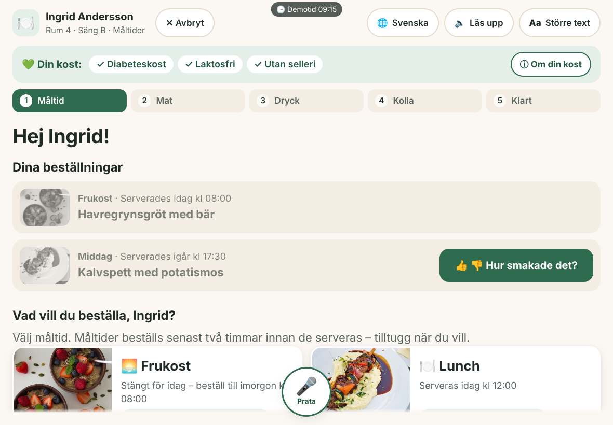
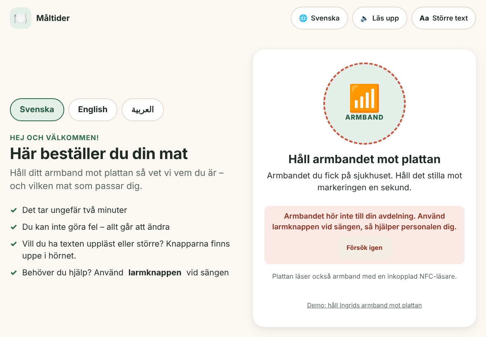
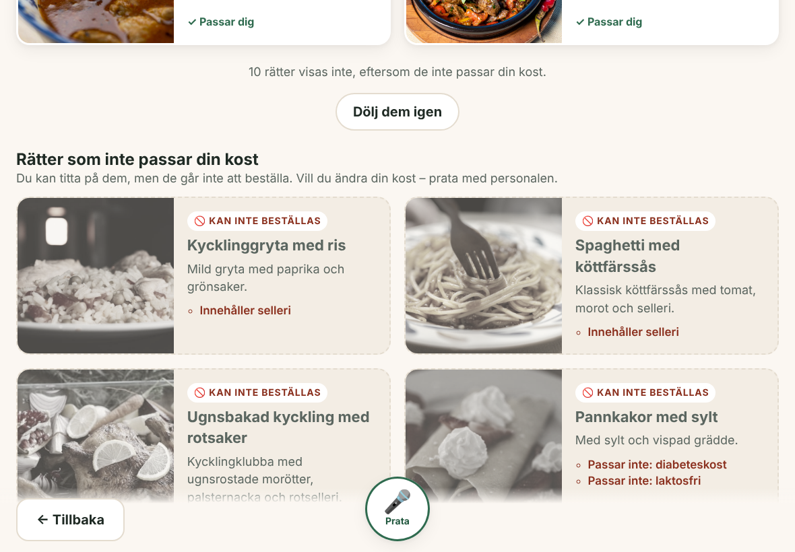
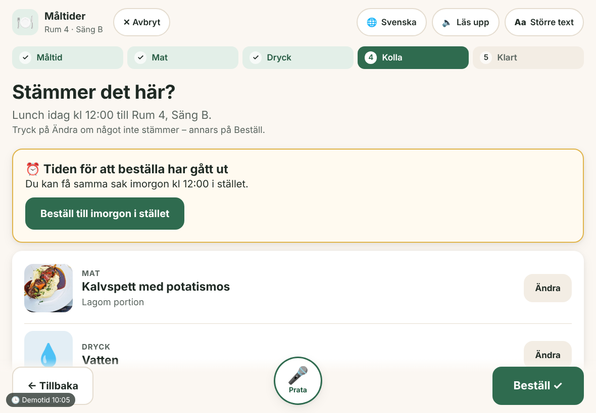
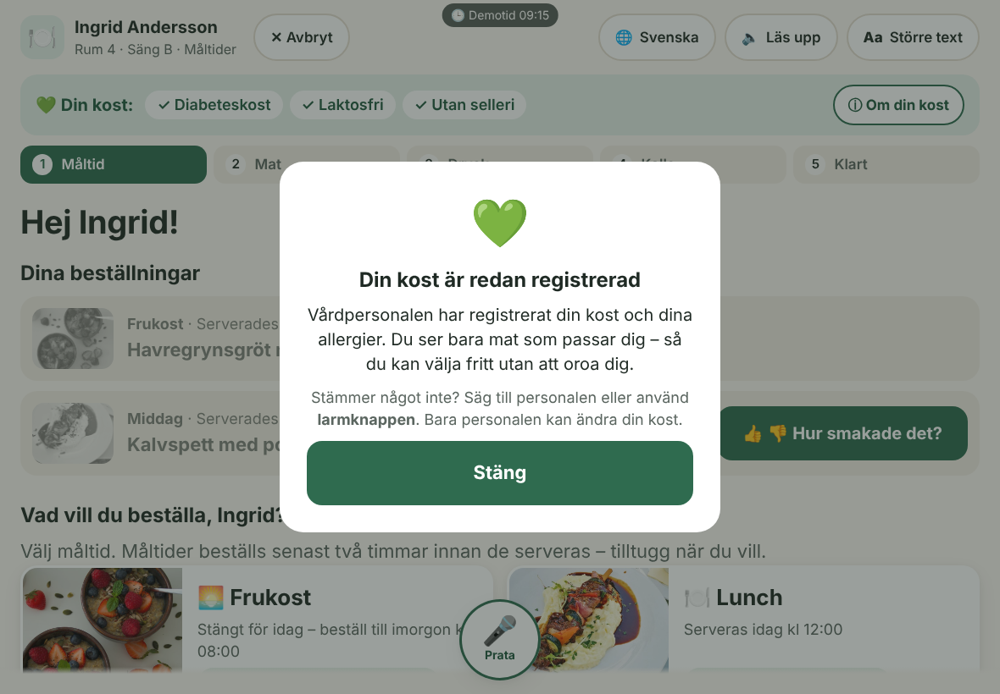
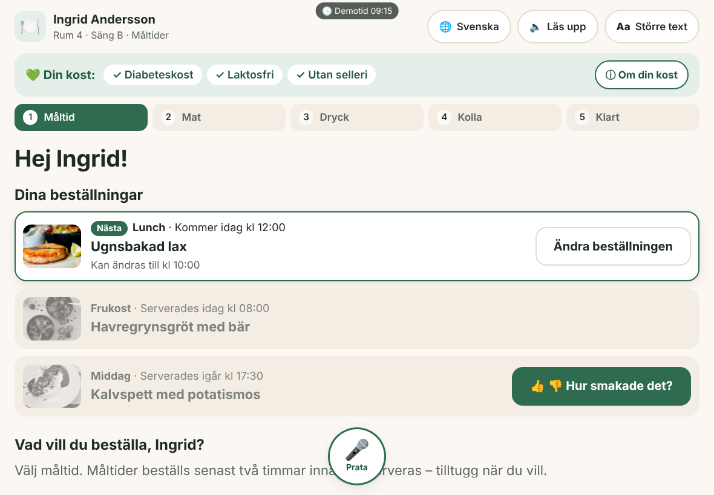

# Ingrids måltid – konceptprototyp

Tävlingsbidrag till *The Great Product Challenge*: Ingrid, 78, återhämtar sig efter en
operation och ska för första gången beställa sin mat på en surfplatta – från inloggning
till bekräftad måltid.

**Leveranserna**

| Leverans | Var |
|---|---|
| 1. Produkten – en komplett resa, surfplattan först | Den här appen (`npm run dev`) |
| 2. Introduktionen | Ingen separat guide – varje sida förklarar sig själv, se [beslut och bedömning](docs/beslut-och-bedomning.md#introduktion-för-nya-användare-15-p) |
| 3. Lanseringen | [60-sekundersvideo](docs/lansering/produktvideo.mp4) · [videomanus](docs/lansering/videomanus.md) · [kom igång-guide (PDF)](docs/lansering/kom-igang.pdf) |
| Underlag för juryn | [Beslut och bedömning](docs/beslut-och-bedomning.md): skyddsräcken, de sex principerna, Cagans fyra risker, testprotokoll |

## Kom igång

```bash
npm install
npm run dev        # http://localhost:3000
```

Logga in genom att hålla Ingrids armband mot plattan. I demon trycker du på
**"Demo: håll Ingrids armband mot plattan"** längst ner på inloggningssidan. Armbandet
innehåller hennes **syntetiska** personnummer **19480302-2328**.

### Inloggning med NFC-armband

Det går inte att skriva in ett personnummer. Plattan läser patientens armband, och det
går på tre sätt:

| Sätt | Var det fungerar |
|---|---|
| **Web NFC** (`NDEFReader`), plattans inbyggda läsare | Chrome på Android, via HTTPS. Första gången trycker man på *Starta armbandsläsaren* och tillåter NFC. Sedan startar läsaren av sig själv. |
| **Inkopplad NFC-läsare** (USB eller Bluetooth) som skriver som ett tangentbord | Alla plattor och webbläsare, även iPad. Läsaren skriver numret snabbt och avslutar med Enter. Långsam inmatning för hand godtas inte. |
| **Demo** | Knappen på inloggningssidan, eller `window.dispatchEvent(new CustomEvent("ingrid-nfc", { detail: "PNR:194803022328" }))` |

Armbandets tagg innehåller en NDEF-textpost (`PNR:ÅÅÅÅMMDDXXXX`). Webbläsare på iPad och
iPhone har ingen Web NFC, så där behövs en inkopplad läsare eller en inbyggd app. Koden
finns i `src/lib/wristband.ts`.

## Användarresan

| Steg | Sida | Vad händer |
|---|---|---|
| 1 | `/` | **Språkval** (svenska, English, العربية) och inloggning med **armbandet** mot plattan. Varje fel har en handling: *Försök igen* eller hänvisning till larmknappen. Har hon ett påbörjat val fortsätter hon direkt där hon var. |
| 2–3 | `/tillfalle` | **"Hej Ingrid!" och hennes beställningar** i tidsordning: nästa måltid överst, och måltider som har passerat gråade. En serverad måltid utan omdöme har knappen *Hur smakade det?*, och en beställning som inte är låst kan ändras. Under listan **väljer hon måltid:** frukost (08:00), lunch (12:00), fika (14:30), middag (17:30) eller **tilltugg** när som helst. Varje kort har en **nedräkning** till låstiden, två timmar före servering. Har tiden passerat står det "Stängt för idag – beställ till imorgon", och beställningen gäller nästa dag. |
| 4 | `/meny` | **Rätter för vald måltid**, med nedräkning. Lunch och middag har 20 rätter. Bara de som passar hennes kostavvikelser visas: allergier, specialkost och konsistens. En rätt är föreslagen med skälet utskrivet. Under menyn står hur många som är dolda. *Visa dem* visar dem gråade med skälet ("Innehåller selleri", "Passar inte: laktosfri", "Konsistens: timbal"), men de går inte att beställa (`/meny?dolda=1`). |
| 5 | `/meny/[id]` | Allergener, portionsstorlek ("Hur hungrig är du?") och önskemål som "Skuren i små bitar". |
| 6 | `/dryck` | Dryck som passar kosten. |
| 7 | `/sammanfattning` | "Stämmer det här?" – allt går att ändra. |
| 8 | `/klart` | Bekräftelse med tid: "Maten kommer till ditt rum ca kl 12:00". |
| – | `/omdome` | **Omdöme i efterhand:** 👍 eller 👎, valfria skäl och "Hur mycket åt du?". |
| – | `/min-smak` | **Min smak:** 👍 eller 👎 på olika sorters mat och ❤️ på önskerätter. |

**Sidhuvudet** visar på varje sida patientens namn, rum och säng, och raden **Din kost**:
diabeteskost, laktosfri och utan selleri. Bakom *Om din kost* står att personalen har
registrerat kosten, att hon bara ser mat som passar och att bara personalen kan ändra den.

Hjälpmedel på varje sida: **Språk**, **Läs upp / Ljud på** och **Större text**. Appen har
ingen egen hjälpknapp, eftersom rummet redan har larmknappar. Där det behövs hänvisar
texten till *larmknappen vid sängen*.

**Ångrat sig?** Knappen **✕ Avbryt** uppe till vänster finns på alla sidor efter
inloggningen, utom på bekräftelsen där beställningen redan är skickad. Avbryt sker
direkt, utan "Är du säker?". Inloggningen visar: "Du har avslutat. Inget är beställt.
Det du hade valt är sparat." och knappen **Ångra – fortsätt där jag var**, som gäller i
2 minuter. Med rösten räcker det att säga "avbryt".

Om Ingrid åt lite eller hade svårt att tugga får **Anna**, hennes sjuksköterska idag, veta
det. Det står vad Anna gör och vad som händer om ingen hinner titta på det: före kl 15
går det vidare till dietisten.

**Avbruten mitt i?** Plattan loggar ut efter 10 minuter utan aktivitet så att ingen annan
ser patientens uppgifter, men valet sparas. Vid nästa inloggning kan hon fortsätta exakt
där hon var. Testa direkt: `window.dispatchEvent(new Event("ingrid-idle"))`.

## Språk

Alla patientskärmar finns på **svenska, engelska och arabiska**. Arabiska visas från höger
till vänster, och uppläsningen sker på valt språk. Texterna finns i `src/lib/i18n.ts`, där
det är lätt att lägga till fler språk. Röstkommandona finns bara på svenska, så på andra
språk används tryck och uppläsning. Den arabiska texten tilltalar Ingrid i femininum. En
riktig lösning behöver anpassa tilltalet efter patienten.

## Omdöme i efterhand – tummen upp eller ner

- **Efter måltiden.** Nästa gång Ingrid loggar in frågar appen först "Hur smakade
  gårdagens middag?". Hon kan svara med 👍 eller 👎, eller hoppa över.
- **Valfria detaljer.** Hon kan välja skäl som "Som hemma", "För kall" eller "Svårt att
  tugga", och svara på *Hur mycket åt du?* (allt, hälften, lite, inget). Det sista ger
  vården tidiga signaler om undernäring.
- **Appen minns.** Menyn visar "👍 Du gillade den" eller "👎 Inte din favorit" vid rätter
  hon har betygsatt.
- **Människan beslutar.** Väljer Ingrid "Svårt att tugga" meddelas personalen, men kosten
  ändras aldrig automatiskt.
- **Röst.** Hon kan säga "tummen upp", "för kall", "jag åt allt" och "skicka".
- **Demo.** På bekräftelsesidan finns länken *"Demo: maten har serverats"*, som hoppar
  fram i tiden så att man kan betygsätta det man just beställde.

## Måltider, nedräkning och låstid

| Måltid | Serveras | Sista beställning | Utbud |
|---|---|---|---|
| Frukost | 08:00 | 06:00 | 6 rätter |
| Lunch | 12:00 | 10:00 | 20 rätter |
| Fika | 14:30 | 12:30 | 4 rätter |
| Middag | 17:30 | 15:30 | 20 rätter |
| Tilltugg | ca 30 min efter beställning | Ingen låstid | 5 rätter |

- **Låstid två timmar** (`LOCK_HOURS` i `src/lib/data.ts`). Nedräkningen visas på måltidskortet, i menyn och i sammanfattningen. Den sista halvtimmen blir den gul.
- **Går tiden ut medan hon väljer** säger sammanfattningen "Tiden för att beställa har gått ut" och erbjuder **Beställ till imorgon i stället**. Beställ-knappen går inte att trycka på förrän det är löst.
- **Flera beställningar.** Efter en beställning kan hon trycka **Beställ något mer**. Måltidsvalet visar "✓ Beställt: Ugnsbakad lax". Beställningen kan ändras fram till låstiden.
- **Önskemål** som "såsen vid sidan" visas bara för lunch och middag. Alla måltider har dryckesvalet **Inget att dricka**.
- **Demotid:** lägg till `?klocka=09:15` i adressen för att ställa appens klocka. En liten markering visar demotiden, och `?klocka=` återställer.

## Kostavvikelser och dolda rätter

Patientens kostavvikelser kommer från vården (`src/lib/data.ts`):

| Avvikelse | Ingrid | Andra nivåer i modellen |
|---|---|---|
| Allergier | Selleri | Fisk, ägg, mjölk, gluten, senap … |
| Specialkost | Diabeteskost, laktosfri | Glutenfri, vegetarisk |
| Konsistens | Normal | Hackad, grov paté, timbal, gelé, flytande |

En rätt kan bara beställas om den inte krockar med någon avvikelse (`dishBlockers`). Av
de 20 rätterna ser Ingrid 10. De andra 10 är dolda: 3 för selleri, 2 för att de inte är
diabeteskost, 3 för att de inte är laktosfria och 2 för fel konsistens (timbal, flytande).
Hon kan välja att visa dem, men de går inte att beställa, inte ens via en direktlänk. Appen
visar skälet och att bara personalen kan ändra kosten.

## Min smak – det Ingrid tycker om

Ingrid når sidan `/min-smak` från bekräftelsen eller från länken under menyn.

- **Favoriträtter med fritext och autocomplete.** Hon skriver i ett sökfält och får förslag ur ett hundratal rätter (`src/lib/foodCatalog.ts`):
  - svensk husman, till exempel korv stroganoff, flygande Jakob, Janssons frestelse och kåldolmar
  - rätter från hela världen, till exempel pad thai, butter chicken, sushi, pho, falafel och paella

  Hon kan söka på kök, så att "thai" eller "indisk" visar de rätterna. Söket fungerar på svenska och engelska och bryr sig inte om accenter. Finns rätten inte i listan kan hon välja **Lägg till ”…”** som egen önskan. Snabbval visar vanliga favoriter, och valda rätter visas som ❤️-chips som går att ta bort.
- **Mat från världen** med 18 kök, flera samtidigt: svensk husman, thailändsk, indisk, italiensk, kinesisk, japansk, vietnamesisk, koreansk, mexikansk, libanesisk, turkisk, persisk, grekisk, spansk, fransk, amerikansk, östeuropeisk samt nord- och östafrikansk.
- **Sorters mat** med 👍 eller 👎, som tidigare.
- **Rösten** fungerar också, till exempel "korv stroganoff", "thai" eller "jag tycker inte om kryddig mat".
- **Menyn anpassas.** Favoriträtter som finns på menyn märks "❤️ Din favorit" och hamnar först, med förslaget *"Eftersom det är en av dina favoriträtter"*. Rätter från kök hon gillar märks till exempel "❤️ Indisk – din smak".

På arabiska visas rätternas engelska namn. Köken är översatta.

Svaren från omdömen och "Min smak" sparas med svenska nycklar och utan att något skickas
till en AI-tjänst. Hur sjukhuset sedan använder dem för menyplaneringen ligger utanför
prototypen – där gäller principen att systemet föreslår och människan bestämmer.

## Ljud och röst

- **Ljudläge.** Ett tryck på **Läs upp** slår på ljudet. Sedan läses varje sida upp
  automatiskt, och varje val bekräftas med en mjuk signal och tal ("Liten portion",
  "Du valde kaffe att dricka …").
- **Röstkommandon.** Tryck på den runda **🎤 Prata**-knappen och säg vad du vill.
  Bubblan visar vad appen hörde. Förstår den inte säger den vad man kan säga i stället.

| Sida | Exempel på vad Ingrid kan säga |
|---|---|
| Välkommen | "ja" · "nej, det är inte jag" |
| Meny | "laxen", "soppa", "den första". En rätt som inte passar henne ger en förklaring. |
| Rätt | "liten", "lagom", "stor" · "skär i bitar", "såsen vid sidan" · "nästa" · "tillbaka" |
| Dryck | "kaffe", "vatten", "mjölk" |
| Sammanfattning | "ja, beställ" · "ändra maten" · "ändra drycken" |
| Klart | "klar" · "ändra" |
| Omdöme | "tummen upp" / "tummen ner" · "för kall", "svårt att tugga" · "jag åt allt" · "skicka" · "hoppa över" |
| Min smak | "jag gillar fisk" · "jag tycker inte om kryddig mat" · "köttbullar" · "skicka" |
| Alla sidor | "läs upp" / "upprepa" · "större text" · "tyst" · "avbryt" |

**Integritet (skyddsräcke 2).** Uppläsningen sker i enheten. Taligenkänningen används
**bara** när webbläsaren kan köra den i plattan (`processLocally`, med en svensk modell som
laddas ner en gång). Kan den inte det döljs mikrofonen, och inget ljud skickas någonsin
till en extern taltjänst eller AI-modell. Rösten finns inte heller på inloggningen.

Mikrofonen syns i webbläsare som har API:t för taligenkänning i enheten (nyare Chrome).
Om en svensk modell saknas säger appen det när man trycker på knappen och döljer den. Utan
mikrofon kan man prova kommandona i konsolen:
`window.dispatchEvent(new CustomEvent("ingrid-voice", { detail: "laxen" }))`.

## Hur vi följer reglerna

| Regel | Så här |
|---|---|
| Allergener och ordinerad kost ändras aldrig automatiskt | Kost och allergier kommer från vården och visas bara. Appen filtrerar menyn men kan aldrig ändra en ordination. Ingrid uppmanas be personalen om något inte stämmer. Rätter som inte passar går inte att välja, inte ens via direktlänk. |
| Patientdata går aldrig okontrollerat till en AI-modell | Prototypen anropar ingen AI-tjänst. Röst tolkas bara i plattan. All data finns lokalt i webbläsaren (sessionStorage). |
| Bara syntetisk data | Ingrid är påhittad. Personnumret är ett officiellt testpersonnummer från Skatteverket. |
| Patientskärmar ska fungera för alla | Svenska, engelska och arabiska, stora tryckytor (≥ 56 px), tydliga kontraster, större text, uppläsning på valt språk, hänvisning till larmknappen, enkelt språk, ett beslut per skärm. |
| Surfplattan först | Layouten är byggd för liggande surfplatta och fungerar även på mobil. |

> **Obs om säkerheten:** Armbandet är säkrare än ett nummer som vem som helst kan skriva,
> men personnumret i klartext på taggen kan läsas av en annan NFC-läsare. I skarp drift
> bör armbandet bara bära ett slumpat band-ID (gärna en signerad eller krypterad tagg, t.ex.
> NTAG 424 DNA). Servern slår upp patienten och kontrollerar att bandet hör till sängen
> som plattan är kopplad till.

## Dokumentation

1. **Förstå problemet** – [docs/steg-1-problemforstaelse.md](docs/steg-1-problemforstaelse.md) · ifyllt lunchkort: [svenska](docs/lunch-mission/lunch-mission-sv.png), [English](docs/lunch-mission/lunch-mission-en.png)
2. **Prototyp** – den här appen
3. **Beslut och bedömning** – [docs/beslut-och-bedomning.md](docs/beslut-och-bedomning.md)
4. **Lansering** – [video](docs/lansering/produktvideo.mp4), [manus](docs/lansering/videomanus.md), [kom igång-guide](docs/lansering/kom-igang.pdf). Videon spelas in igen med `scripts/spela-in-video.cjs`.

## Matbilder

Fotona i `public/mat/` kommer från [Pexels](https://www.pexels.com/license/) och får användas fritt, utan krav på att fotografen anges. Kalvspettsbilden är beskuren.

| Rätt | Källa |
|---|---|
| Havregrynsgröt | https://www.pexels.com/photo/5604832/ |
| Kokt ägg | https://www.pexels.com/photo/2402506/ |
| Yoghurt med müsli | https://www.pexels.com/photo/8892364/ |
| Stekt ägg med bacon | https://www.pexels.com/photo/5840085/ |
| Varm smörgås | https://www.pexels.com/photo/15110224/ |
| Omelett | https://www.pexels.com/photo/1437268/ |
| Blåbärsmuffin | https://www.pexels.com/photo/7935281/ |
| Fruktsallad | https://www.pexels.com/photo/8755094/ |
| Kanelbulle | https://www.pexels.com/photo/31762658/ |
| Chokladtårta | https://www.pexels.com/photo/3740237/ |
| Färsk frukt | https://www.pexels.com/photo/5512652/ |
| Nötmix | https://www.pexels.com/photo/529632/ |
| Ostsmörgås | https://www.pexels.com/photo/4559174/ |
| Yoghurt med bär | https://www.pexels.com/photo/8063447/ |
| Chokladbakelse | https://www.pexels.com/photo/24247232/ |
| Ärtsoppa med fläsk | https://www.pexels.com/photo/7190222/ |
| Kycklingcurry med ris | https://www.pexels.com/photo/674574/ |
| Kalops | https://www.pexels.com/photo/1618952/ |
| Stekt sejfilé | https://www.pexels.com/photo/15146204/ |
| Pannbiff | https://www.pexels.com/photo/4210799/ |
| Gulaschsoppa | https://www.pexels.com/photo/8024112/ |
| Vegetarisk bönchili | https://www.pexels.com/photo/5713756/ |
| Spaghetti med köttfärssås | https://www.pexels.com/photo/31637793/ |
| Ugnsbakad kyckling med rotsaker (beskuren) | https://www.pexels.com/photo/6210764/ |
| Panerad fisk | https://www.pexels.com/photo/11513615/ |
| Lasagne | https://www.pexels.com/photo/13823542/ |
| Kycklingschnitzel | https://www.pexels.com/photo/16696798/ |
| Köttfärstimbal (bild: potatispuré) | https://www.pexels.com/photo/30635680/ |
| Näringsrik grönsakssoppa | https://www.pexels.com/photo/8738014/ |
| Kalvspett med potatismos | https://www.pexels.com/photo/2739250/ |
| Ugnsbakad lax | https://www.pexels.com/photo/2374946/ |
| Kycklinggryta med ris | https://www.pexels.com/photo/21822134/ |
| Grönsakssoppa | https://www.pexels.com/photo/34314393/ |
| Pannkakor med sylt | https://www.pexels.com/photo/3225506/ |
| Fiskgratäng | https://www.pexels.com/photo/33042510/ |

AI-genererade bilder har vi provat (Pollinations och FLUX via Hugging Face), men utan
API-nyckel blev kvaliteten för låg eller kvoten tog slut. Med en nyckel går det att
generera bilder i en enhetlig stil.

Vill ni byta en bild? Lägg en ny fil i `public/mat/` och ändra `image` i `src/lib/data.ts`. I skarp drift fotograferar köket sina egna rätter.

## Skärmbilder

| | |
|---|---|
|  |  |
|  |  |
|  |  |
|  |  |
|  |  |
|  |  |
|  |  |
|  |  |
|  |  |
|  |  |
