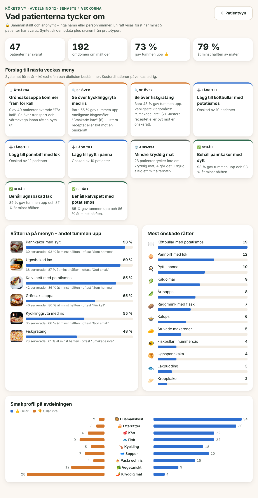

# Ingrids måltid – konceptprototyp

Tävlingsbidrag till *The Great Product Challenge*: Ingrid ligger på sjukhus och ska för
första gången beställa sin mat på en surfplatta – från inloggning till bekräftad måltid.

## Kom igång

```bash
npm install
npm run dev        # http://localhost:3000
```

Logga in med Ingrids **syntetiska** personnummer **19480302-2328** (eller tryck på
"Demo: fyll i Ingrids personnummer" längst ner på inloggningssidan).

## Användarresan

| Steg | Sida | Vad händer |
|---|---|---|
| 1 | `/` | Inloggning med personnummer på ett stort sifferblock på skärmen. Numret kontrolleras (datum och kontrollsiffra) och felen förklaras i klartext. |
| 2 | `/valkommen` | "Hej Ingrid! Stämmer det här?" – namn, rum, säng, kost och allergier. |
| 3 | `/meny` | **Foton på maten.** Bara rätter som passar hennes kost och allergier visas. Det står hur många som är dolda och varför. |
| 4 | `/meny/[id]` | Allergener, portionsstorlek ("Hur hungrig är du?") och önskemål som "Skuren i små bitar". |
| 5 | `/dryck` | Dryck som passar kosten. |
| 6 | `/sammanfattning` | "Stämmer det här?" – allt går att ändra. |
| 7 | `/klart` | Bekräftelse med tid: "Maten kommer till ditt rum ca kl 12:00". |
| – | `/omdome` | **Omdöme i efterhand:** 👍 eller 👎, valfria skäl och "Hur mycket åt du?". |
| – | `/min-smak` | **Min smak:** 👍 eller 👎 på olika sorters mat och ❤️ på önskerätter. |
| – | `/koket` | **Kökets vy** (personal): anonym sammanställning och förslag till nästa meny. |

Hjälpmedel på varje sida: **Läs upp / Ljud på**, **Större text** och **Hjälp**, som
kallar på personalen.

## Omdöme i efterhand – tummen upp eller ner

- **Efter måltiden.** Nästa gång Ingrid loggar in frågar appen först "Hur smakade
  gårdagens middag?". Hon kan svara med 👍 eller 👎, eller hoppa över.
- **Valfria detaljer.** Hon kan välja skäl som "Som hemma", "För kall" eller "Svårt att
  tugga", och svara på *Hur mycket åt du?* (allt, hälften, lite, inget). Det sista ger
  vården tidiga signaler om undernäring.
- **Appen minns.** Menyn visar "👍 Du gillade den" eller "👎 Inte din favorit" vid rätter
  hon har betygsatt.
- **Människan beslutar.** Väljer Ingrid "Svårt att tugga" meddelas personalen, men kosten
  ändras aldrig automatiskt.
- **Röst.** Hon kan säga "tummen upp", "för kall", "jag åt allt" och "skicka".
- **Demo.** På bekräftelsesidan finns länken *"Demo: maten har serverats"*, som hoppar
  fram i tiden så att man kan betygsätta det man just beställde.

## Smak och önskerätter blir underlag för menyn

**Ingrid (`/min-smak`).** Hon når sidan från bekräftelsen ("Vad tycker du om för mat?")
eller från länken under menyn.
- 👍 eller 👎 på sorters mat: husmanskost, fisk, kyckling, kött, vegetariskt, soppor,
  kryddig mat, pasta och ris, efterrätter.
- ❤️ på önskerätter som köttbullar, pannbiff, kåldolmar och ärtsoppa.
- Med rösten kan hon säga till exempel "jag gillar fisk", "jag tycker inte om kryddig
  mat" eller "köttbullar". Appen hör skillnad på "gillar" och "gillar inte".
- **Hennes meny anpassas direkt.** Rätter som matchar det hon gillar hamnar först och
  märks "❤️ Du gillar fisk". Sådant hon ogillar hamnar sist men döljs inte.

**Köket (`/koket`, länk på inloggningssidan).**
- Sidan lägger ihop syntetiska svar från 46 patienter med svaren som lämnats i prototypen.
  Ingrids önskan om köttbullar ändrar till exempel siffran direkt.
- Den visar nyckeltal (andel tummen upp, andel som åt minst hälften), betyg per rätt
  med vanligaste svaret, de mest önskade rätterna och avdelningens smakprofil.
- **Förslag till nästa veckas meny** tas fram med enkla regler som går att förklara:

  | Förslag | Regel |
  |---|---|
  | Behåll | Minst 75 % tummen upp |
  | Se över | Under 55 % tummen upp, med vanligaste klagomålet |
  | Lägg till | De mest önskade rätterna som inte finns på menyn |
  | Åtgärda | Minst 15 % svarade "För kall", så transporten ses över innan rätten byts ut |
  | Anpassa | Sorter som fler än dubbelt så många ogillar som gillar |

- **Reglerna följs.** Systemet föreslår och kökschefen och dietisten bestämmer.
  Kostordinationer påverkas aldrig.
- **Anonymt.** Köket ser bara summor, inga namn eller personnummer. En rätt visas först
  när minst 5 patienter har svarat.
- **Inga AI-anrop.** Förslagen räknas fram i appen, så ingen patientdata lämnar den.

## Ljud och röst

- **Ljudläge.** Ett tryck på **Läs upp** slår på ljudet. Sedan läses varje sida upp
  automatiskt, och varje val bekräftas med en mjuk signal och tal ("Liten portion",
  "Du valde kaffe att dricka …").
- **Röstkommandon.** Tryck på den runda **🎤 Prata**-knappen och säg vad du vill.
  Bubblan visar vad appen hörde. Förstår den inte säger den vad man kan säga i stället.

| Sida | Exempel på vad Ingrid kan säga |
|---|---|
| Välkommen | "ja" · "nej, det är inte jag" |
| Meny | "laxen", "soppa", "den första". En rätt som inte passar henne ger en förklaring. |
| Rätt | "liten", "lagom", "stor" · "skär i bitar", "såsen vid sidan" · "nästa" · "tillbaka" |
| Dryck | "kaffe", "vatten", "mjölk" |
| Sammanfattning | "ja, beställ" · "ändra maten" · "ändra drycken" |
| Klart | "klar" · "ändra" |
| Omdöme | "tummen upp" / "tummen ner" · "för kall", "svårt att tugga" · "jag åt allt" · "skicka" · "hoppa över" |
| Min smak | "jag gillar fisk" · "jag tycker inte om kryddig mat" · "köttbullar" · "skicka" |
| Alla sidor | "hjälp" · "läs upp" / "upprepa" · "större text" · "tyst" |

Rösten fungerar i Chrome, Edge och Safari via webbläsarens inbyggda Web Speech API. Det
kräver `localhost` eller https och tillåten mikrofon. Utan mikrofon kan man prova i
konsolen: `window.dispatchEvent(new CustomEvent("ingrid-voice", { detail: "laxen" }))`.

**Integritet.** Uppläsningen sker alltid i enheten. Taligenkänningen körs i enheten om
webbläsaren har en svensk modell (`processLocally`). Annars skickar webbläsaren ljudet
till sin egen taltjänst, till exempel Googles i Chrome. Därför finns rösten *inte* på
inloggningen, så personnumret sägs aldrig högt eller skickas iväg som ljud. Under
vistelsen tar rösten bara emot menyval. I skarp drift bör igenkänningen ske i enheten
eller i en godkänd tjänst inom vårdgivarens kontroll.

## Hur vi följer reglerna

| Regel | Så här |
|---|---|
| Allergener och ordinerad kost ändras aldrig automatiskt | Kost och allergier kommer från vården och visas bara. Appen filtrerar menyn men kan aldrig ändra en ordination. Ingrid uppmanas be personalen om något inte stämmer. Rätter som inte passar går inte att välja, inte ens via direktlänk. |
| Patientdata går aldrig okontrollerat till en AI-modell | Prototypen anropar ingen AI-tjänst. All data finns lokalt i webbläsaren (sessionStorage). |
| Bara syntetisk data | Ingrid är påhittad. Personnumret är ett officiellt testpersonnummer från Skatteverket. |
| Patientskärmar ska fungera för alla | Stora tryckytor (≥ 56 px), tydliga kontraster, större text, uppläsning, hjälpknapp, enkelt språk, ett beslut per skärm. |
| Surfplattan först | Layouten är byggd för liggande surfplatta och fungerar även på mobil. |

> **Obs:** Att logga in med bara personnummer räcker inte i skarp drift. Prototypen
> visar *upplevelsen*. I verkligheten behövs en kontroll till, till exempel att
> plattan är kopplad till sängen eller att personalen bekräftar.

## Dokumentation

1. **Förstå problemet** – [docs/steg-1-problemforstaelse.md](docs/steg-1-problemforstaelse.md) · ifyllt lunchkort: [svenska](docs/lunch-mission/lunch-mission-sv.png), [English](docs/lunch-mission/lunch-mission-en.png)
2. **Prototyp** – den här appen

## Matbilder

Fotona i `public/mat/` kommer från [Pexels](https://www.pexels.com/license/) och får användas fritt, utan krav på att fotografen anges. Kalvspettsbilden är beskuren.

| Rätt | Källa |
|---|---|
| Kalvspett med potatismos | https://www.pexels.com/photo/2739250/ |
| Ugnsbakad lax | https://www.pexels.com/photo/2374946/ |
| Kycklinggryta med ris | https://www.pexels.com/photo/21822134/ |
| Grönsakssoppa | https://www.pexels.com/photo/34314393/ |
| Pannkakor med sylt | https://www.pexels.com/photo/3225506/ |
| Fiskgratäng | https://www.pexels.com/photo/33042510/ |

AI-genererade bilder har vi provat (Pollinations och FLUX via Hugging Face), men utan
API-nyckel blev kvaliteten för låg eller kvoten tog slut. Med en nyckel går det att
generera bilder i en enhetlig stil.

Vill ni byta en bild? Lägg en ny fil i `public/mat/` och ändra `image` i `src/lib/data.ts`. I skarp drift fotograferar köket sina egna rätter.

## Skärmbilder

| | |
|---|---|
|  |  |
|  |  |
|  |  |
|  |  |
|  |  |
|  |  |
|  | |
